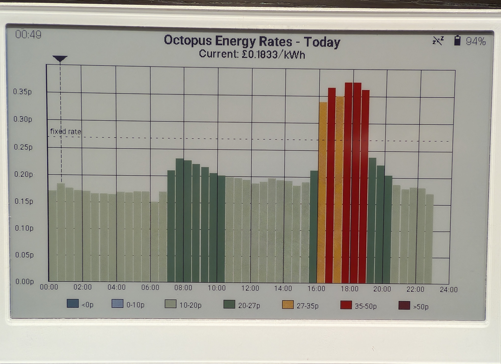

# Octopus Agile energy rate colour e-ink dashboard
An ESPHome dashboard showing half-hourly Octopus Agile electricity rates on a colour e-ink display (reTerminal E1002).

Mostly written through Claude Code.



Until tomorrow's rates are published (usually around 4-5pm), the chart shows today from midnight to midnight. Once they are, it shows from the current half-hour to the last known rate, with a tag marking midnight.

## Home Assistant setup

The display gets its rates from the [Octopus Energy integration](https://github.com/BottlecapDave/HomeAssistant-OctopusEnergy)'s `current_day_rates` and `next_day_rates` event entities, through two template sensors. The integration stores each rate's `start` as a datetime, which ESPHome can't receive, so these sensors turn the rates into plain JSON.

Add the sensors to `configuration.yaml`, replacing the meter serial and MPAN in the entity IDs with your own (here and in `reterminal-e1002.yaml`). Then reload template entities from **Tools → YAML**:

```yaml
template:
  - sensor:
      - name: "Octopus Rates JSON"
        unique_id: octopus_rates_json
        state: "{{ states('event.octopus_energy_electricity_22l4134239_1200031450010_current_day_rates') }}"
        attributes:
          rates_json: >
            
            [{"start":"{{ rate.start.isoformat() }}","end":"{{ rate.end.isoformat() }}","value_inc_vat":{{ rate.value_inc_vat }}}{{ "," if not loop.last else "" }}][]
      - name: "Octopus Next Rates JSON"
        unique_id: octopus_next_rates_json
        state: "{{ states('event.octopus_energy_electricity_22l4134239_1200031450010_next_day_rates') }}"
        attributes:
          rates_json: >
            
            [{"start":"{{ rate.start.isoformat() }}","end":"{{ rate.end.isoformat() }}","value_inc_vat":{{ rate.value_inc_vat }}}{{ "," if not loop.last else "" }}][]
```

Each time it wakes, the display waits (up to 30 seconds) for both sensors before redrawing. If tomorrow's rates aren't known yet, the next day sensor's `rates_json` is an empty list.
